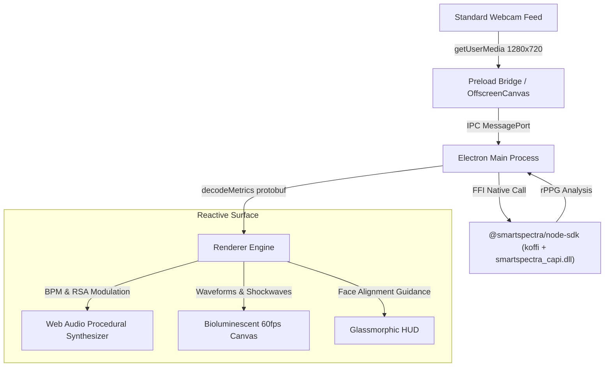

# PulseTones — Bio-Acoustic Generative Soundscape

> **Submission for the [Presage SmartSpectra SDK Challenge](https://dev.to/challenges/presage-2026-11-04)**  
> **Prize Category Nomination:** *Most Creative or Delightful Use*

**PulseTones** is a contactless, real-time bio-acoustic ambient soundscape and bioluminescent visualizer. By using the **Presage SmartSpectra SDK**, PulseTones captures subtle optical human physiological signals (heart rate, breathing waveform, heart rate variability, and facial expressions) through an ordinary webcam via remote photoplethysmography (rPPG)—turning your physical state into an evolving generative ambient concert.

---

## 🌟 How It Responds to Human Signals

PulseTones transforms physiological rhythms into musical and visual expressions in real-time:

1. **Cardiac Rhythm (rPPG Pulse Rate):**  
   The measured pulse rate (BPM) drives a resonant sub-bass acoustic pulse oscillator. Visual shockwaves expand outward from the bioluminescent aura synchronously with every heartbeat.
2. **Respiration Cadence (Chest/Abdomen Breathing Trace):**  
   Continuous respiratory movement directly modulates the cutoff frequency of a warm 24dB/octave resonant low-pass filter ($220\text{ Hz} \leftrightarrow 2400\text{ Hz}$). When you inhale, the soundscape opens up into bright, shimmering harmonic light; when you exhale, the filter deepens into grounding, meditative warm roots.
3. **Autonomic Balance (HRV RMSSD):**  
   Heart Rate Variability dictates the harmonic complexity and reverberation density. Elevated HRV (calm, coherent state) introduces lush pentatonic chords and spatial stereo delay; lower HRV grounds the drone into steady fundamental fifths to induce parasympathetic relaxation.
4. **Expression Dynamics (Smile Detection):**  
   Detected smiling triggers a crystalline pentatonic chime cascade (high bell-like FM arpeggios that diffuse across the stereo field).

---

## 🏗️ Architecture



- **Runtime:** Electron 45+ with Node.js 22+
- **Vitals SDK:** `@smartspectra/node-sdk` (Windows x64 C-ABI runtime)
- **Audio Engine:** Pure Web Audio API (zero external sound samples; 100% procedural oscillators, biquad filters, and stereo delay network)
- **Visuals:** Native HTML5 60fps Canvas with high-DPI scaling and particle physics
- **Fallback Simulation:** Built-in high-fidelity synthetic physiological waveform generator for automated testing and demonstrations without a camera.

---

## 🔒 Consent and Data Handling

*(Mandatory compliance disclosure for the Presage SmartSpectra SDK Challenge)*

- **Explicit User Consent:** On first launch, PulseTones presents an unmissable Consent and Data Handling modal. Camera feeds are never accessed until the user explicitly clicks *"I Understand & Consent"*.
- **100% Local In-Memory Processing:** Video frames captured from the webcam are processed strictly on-device in volatile RAM by the SmartSpectra SDK. 
- **Zero Storage & Zero Transmission:** No video frames, photographs, or raw biometric recordings are ever written to disk, saved locally, or transmitted to any external server or cloud service.
- **No Identification:** The software extracts aggregate optical waveforms (color variations for rPPG and landmark motion); no facial recognition or biometric identification is performed.
- **Non-Medical Wellness Purpose:** PulseTones is designed exclusively as an artistic, interactive generative music installation. It provides **NO** medical diagnosis, treatment, or clinical monitoring claims.

---

## 🚀 Getting Started

### Prerequisites
- [Node.js](https://nodejs.org/) (v20 or higher recommended)
- A standard USB webcam or built-in laptop camera
- A Presage Developer API Key (Free registration at [physiology.presagetech.com/auth/register](https://physiology.presagetech.com/auth/register))

### Installation

1. Clone this repository:
   ```bash
   git clone https://github.com/YTxFSGAMERz/pulse-tones.git
   cd pulse-tones
   ```

2. Install dependencies:
   ```bash
   npm install
   ```

3. Set up your API Key:
   Copy `.env.example` to `.env` and insert your key:
   ```bash
   cp .env.example .env
   ```
   *(Or simply launch the app and paste your API key into the Settings modal!)*

4. Run the application:
   ```bash
   npm start
   ```

---

## 🎮 Modes of Operation

1. **Live Camera Mode:**  
   Click **"Start Live Camera"**. Align your face inside the target preview. Sit comfortably in good lighting. Watch your vitals lock in and hear the soundscape adapt to your breathing and pulse!
2. **Demo Simulation Mode:**  
   Click **"Demo Simulation"** to experience the bio-acoustic synthesis engine driven by a mathematical physiological waveform generator (14 breaths/min, 72 BPM, dynamic RSA modulation). Ideal for testing or evaluating the app without an active webcam.

---

## 📜 License
MIT License. SmartSpectra SDK components are Copyright (C) Presage Technologies, Inc.
