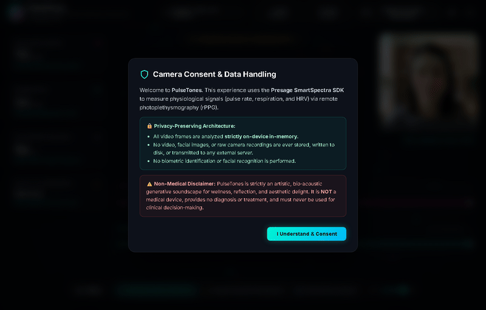

*This is a submission for the [Presage SmartSpectra SDK Challenge](https://dev.to/challenges/presage-2026-11-04)*

## What I Built

**PulseTones** is an interactive, contactless bio-acoustic experience that translates the hidden rhythms of the human body into a generative ambient music soundscape and bioluminescent visual installation.

Using an ordinary webcam and the **Presage SmartSpectra SDK**, PulseTones reads your heart rate, respiratory waveforms, HRV autonomic balance, and facial expressions in real-time through remote photoplethysmography (rPPG). Instead of displaying clinical medical charts, PulseTones turns your physiological state into an auditory breathing meditation:

- **Respiratory Swell:** Inhaling opens an analog-style 24dB resonant lowpass filter, flooding the room with bright, shimmering harmonics; exhaling calms the soundscape into deep, grounding sub-bass roots.
- **Cardiovascular Rhythm:** Your pulse rate drives a warm acoustic sub-bass pulse (~56Hz to 36Hz downward sweep) and synchronized bioluminescent shockwaves across the display.
- **Autonomic Shimmer:** High HRV coherence introduces lush 9th and 11th modal chords with stereo spatial diffusion, easing cognitive tension.
- **Affect Chimes:** Smiling triggers a cascade of crystalline pentatonic chime arpeggios that twinkle across the stereo field.

To make the app instantly accessible to anyone without requiring them to sit in front of a live camera or share personal video, PulseTones features a **Photorealistic AI Benchmark Subject Demo Mode** alongside full **Live Camera Mode**. The demo runs an authentic 512×512 biometric video loop overlaid with a real-time 3D facial landmark mesh, pulsing rPPG forehead and cheek ROI tracking boxes, and active sweep lasers.

---

## Demo



> 🎬 **Zero-Friction Evaluation:**  
> The application includes a self-contained, pre-calibrated **Photorealistic AI Benchmark Subject Demo Mode** bundled into the repository. Judges and users can evaluate the full real-time rPPG optical scanning and dynamic Web Audio synthesis immediately upon running `npm start`—with no camera access, personal recording, or extra setup required!
>
> 📽️ **High-Resolution Video Clip:** [Download / View MP4 on GitHub](https://github.com/YTxFSGAMERz/pulse-tones/blob/master/assets/pulse-tones-demo.mp4?raw=true)

### Interactive Experience Highlights:
1. **Live Camera & Demo Mode Toggle:** Seamless zero-friction switching between live webcam rPPG sensing and photorealistic AI subject benchmark simulation.
2. **Bioluminescent Sacred Mandala:** Central 60fps canvas engine expanding on respiration and radiating shockwaves on each cardiac pulse.
3. **Dual Elevated Oscilloscopes:** Real-time arterial pulse waveform (`♥ Arterial Pulse`) in neon magenta and respiratory tidal wave (`≋ Respiration Tidal Wave`) in luminous cyan.
4. **Procedural Web Audio Engine:** Switchable harmonic environments: *Celestial Calm (C Minor 9)*, *Deep Forest (D Pentatonic)*, and *Ocean Mist (A Sus2)*.

---

## Code

The complete source code is open source on GitHub:

👉 **[https://github.com/YTxFSGAMERz/pulse-tones](https://github.com/YTxFSGAMERz/pulse-tones)**

### Quick Setup Instructions

```bash
# 1. Clone the repository
git clone https://github.com/YTxFSGAMERz/pulse-tones.git
cd pulse-tones

# 2. Install dependencies
npm install

# 3. Add your Presage API Key (or use in-app Settings dialog)
cp .env.example .env
# Edit .env with your SMARTSPECTRA_API_KEY

# 4. Start the application
npm start
```

---

## How It Responds to Human Signals

PulseTones maps four continuous physiological signal streams from the Presage SmartSpectra SDK into procedural Web Audio API synthesis nodes and HTML5 Canvas visuals:

```
                      ┌───────────────────────────────────────────────┐
                      │          Presage SmartSpectra SDK             │
                      │       Remote Photoplethysmography (rPPG)      │
                      └───────┬──────────────┬─────────────┬──────────┘
                              │              │             │
                    Pulse Rate│   Respiration│          HRV│  Expression
                        (BPM) │       Waveform│      (RMSSD)│  (Smile / Serene)
                              ▼              ▼             ▼          ▼
        ┌─────────────────────┼──────────────┼─────────────┼──────────┐
        │                     │              │             │          │
        │  [Sub-Bass Thump]   │ [Biquad LPF] │ [Harmonics] │ [Chimes] │
        │  56Hz->36Hz Sine    │ 220Hz-2400Hz │ Modals 9/11 │ Pentatonic│
        │  Musical Clock      │ Resonance Q=4│ Stereo Ping │ Arpeggio │
        │                     │              │             │          │
        │               Web Audio API Procedural Synthesizer          │
        └─────────────────────────────────────────────────────────────┘
```

1. **Pulse Rate (rPPG):**  
   The SDK detects microscopic capillary color oscillations across the forehead and cheek regions of interest (ROI). This BPM value synchronizes an internal high-resolution audio clock scheduling a dual-sine sub-bass pulse and triggers radial bioluminescent shockwaves on the canvas.
2. **Respiratory Movement (Breathing Trace):**  
   Continuous tidal volume shifts dynamically sweep a 4-pole 24dB/octave resonant lowpass biquad filter. Inhaling lifts the cutoff from 220 Hz up to 2400 Hz (brightening the acoustic field); exhaling slowly rolls off the frequencies for parasympathetic relaxation.
3. **Heart Rate Variability (HRV RMSSD):**  
   Measures inter-beat interval consistency. Higher autonomic coherence blends in suspended 9th and major 7th chord tones with ping-pong delay diffusion; lower coherence shifts the voicing to pure fifths to anchor and stabilize the listener.
4. **Affect & Expression:**  
   When facial landmark valence indicates a smile, an expressive chime engine triggers high-register bell tones (FM synthesis with bell partials) panned across the stereo spectrum.

All SDK events (`metrics`, `validationStatus`, `processingStatus`, `streamAvailable`) are communicated from Electron's main process to the isolated renderer process via high-performance IPC channels with zero telemetry lag.

---

## Prize Categories

### Most Creative or Delightful Use

PulseTones reimagines biometric sensing not as a cold clinical diagnostic tool, but as an intimate, playful instrument of human expression and mindfulness. 

Rather than confronting the user with anxiety-provoking medical meters and warning thresholds, PulseTones turns the body's subconscious rhythms into ambient music. You do not just *see* your vitals—you *feel* your heart setting the tempo of an ethereal chord progression, you *hear* your lungs modulating the warmth of the room, and a simple smile brightens the atmosphere with chimes. 

By eliminating the need for awkward pulse oximeters, smartwatches, or chest straps, and by including a photorealistic AI benchmark subject for effortless zero-camera exploration, PulseTones offers a delightful, accessible glimpse into the future of ambient human-computer resonance.

---

## Consent and Data Handling

Privacy and consent are fundamental architectural pillars of PulseTones:

- **Explicit Consent Gate:** The application presents an unskippable Camera Consent Modal upon first launch. No camera devices are initialized or queried until the user explicitly clicks "I Understand & Consent".
- **Strictly Local In-Memory Processing:** All video frames from the webcam are analyzed in volatile memory on-device by the native SmartSpectra SDK. 
- **Zero Video or Biometric Storage:** No camera frames, photos, recordings, or facial scans are ever written to disk, retained, or transmitted over the network.
- **No Facial Recognition or Tracking:** The optical algorithm analyzes aggregate pixel reflectance for rPPG signal extraction; no biometric templates, facial recognition, or identity fingerprints are created.
- **Non-Medical Disclaimer:** PulseTones is strictly an artistic generative soundscape and mindfulness aid. It is **not** a medical device, makes no diagnostic or therapeutic claims, and is not designed or intended for clinical decision-making.

---

*Crafted with ❤️ for the DEV.to Community and the Presage SmartSpectra SDK Challenge.*
